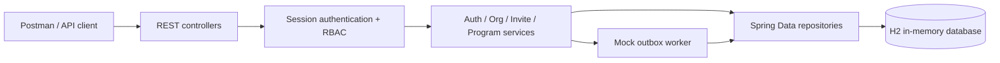

# Organization Platform API


A Java/Spring Boot REST API prototype for managing organizations, authentication, member invitations and programs. Built as a take-home exercise and portfolio project, it focuses on **server-side sessions, role-based access control, organization-scoped operations, transactional capacity checks and a simulated email outbox**.

**Project status:** local development prototype, **not a deployed SaaS product**. Email delivery is simulated; the configured H2 database is in-memory and resets when the application stops.

## What it implements

| Area | Implementation |
| --- | --- |
| Authentication | Registration, verification tokens, BCrypt password hashing, login, refresh-token rotation and logout |
| Sessions | **Opaque UUID bearer tokens** backed by database session records; refresh tokens stored separately |
| Organizations | Organization creation on signup, profile updates and completeness/missing-field reporting |
| Membership | ADMIN, MANAGER and MEMBER roles; admin-issued invitations and token-based acceptance |
| Programs | Organization-scoped creation, updates, listing, detail retrieval and soft archiving |
| Plan limits | FREE / PRO / ENTERPRISE models; member and program limits checked during creation/acceptance |
| Email outbox | Queued mock deliveries, attempt counts, retry scheduling and failure simulation |
| Diagnostics | Public health check and lightweight Prometheus-style metrics |
| Errors | Shared error-envelope handling and request validation |

**Notable design decisions**

- **Database-backed access sessions instead of JWTs.** Clients send `Authorization: Bearer <accessToken>`; the API resolves it against the stored, non-revoked, unexpired session.
- **Refresh rotation and revocation.** Refreshing replaces the access-session identifier and revokes the used refresh token; logout revokes the session and its linked refresh tokens.
- **Organization boundaries.** Program queries scope records to the caller's organization. Managers and admins can mutate programs; regular members can read.
- **Capacity checks in transactions.** Program creation, invite acceptance and plan changes use an organization row lock where implemented, helping prevent concurrent operations from exceeding limits.
- **Inspectable asynchronous behavior.** Verification and invitations pass through an outbox with `QUEUED`, `SENT` and `FAILED` states. Delivery is simulated, not an actual SMTP integration.

## Technology

Java 17 · Spring Boot 3.1.6 · Spring Security · Spring Data JPA / Hibernate · H2 · Jakarta Validation · Lombok · Maven · JUnit 5 · Mockito · Postman

## Architecture at a glance



Relevant source folders:

- `src/main/java/com/Semicolon/controllers/` — HTTP endpoints
- `src/main/java/com/Semicolon/service/` — business workflows and validations
- `src/main/java/com/Semicolon/security/` and `config/` — session filter and Spring Security setup
- `src/main/java/com/Semicolon/data/` — JPA models and repositories
- `src/main/java/com/Semicolon/service/utils/OutboxWorker.java` — simulated mail attempts and retries
- `src/test/java/com/Semicolon/` — JUnit/Mockito service tests

## Run locally

**Requirements:** JDK 17+ and Maven installed (`mvn` available on your PATH).

```bash
git clone https://github.com/SirOlash/GumOrganizationPlatformTakeHomeTask.git
cd GumOrganizationPlatformTakeHomeTask
mvn clean test
mvn spring-boot:run
```

The API listens on **http://localhost:8080**. The checked-in development configuration uses:

- `jdbc:h2:mem:interviewdb` for local data (automatically discarded on shutdown).
- Hibernate `create-drop`, which recreates the schema; this is **not** a persistence or migration setup for production.
- H2 console at **http://localhost:8080/h2-console** with JDBC URL `jdbc:h2:mem:interviewdb`, username `sa` and an empty password.

For predictable demonstration of email verification, set the mock delivery mode **before** starting Spring Boot:

**PowerShell (Windows):**

```powershell
$env:SIMULATE_EMAIL_BEHAVIOUR = "ALWAYS_SUCCESS"
mvn spring-boot:run
```

**Bash (macOS/Linux):**

```bash
SIMULATE_EMAIL_BEHAVIOUR=ALWAYS_SUCCESS mvn spring-boot:run
```

Supported modes: `ALWAYS_SUCCESS`, `ALWAYS_FAIL`, `RANDOM` (the current default). There is **no real email service** behind these settings.

> **Security:** The included `application.properties` uses local-development defaults, enables the H2 console and verbose logging, and contains example Spring Security user settings. Do not expose this configuration to the public internet or use real personal credentials. No production deployment is provided.

## API routes

Except for registration, verification, login and token operations, routes generally require an **opaque session access token** in the `Authorization: Bearer <accessToken>` header.

| Method | Endpoint | Purpose |
| --- | --- | --- |
| POST | `/v1/auth/signup` | Register a user and optionally create an organization; returns a verification token |
| POST | `/v1/auth/verify-email` | Verify an email using its token in the Authorization header |
| POST | `/v1/auth/login` | Sign in and obtain `accessToken` and `refreshToken` |
| POST | `/v1/auth/refresh-token` | Rotate a refresh token and access session |
| POST | `/v1/auth/logout` | Revoke a session using `sessionId` in the request body |
| GET | `/org/me` | Retrieve the caller's organization profile and completeness |
| PATCH | `/org/update-org-profile` | Update organization profile fields |
| PATCH | `/org/update-plan` | Change organization plan (see **Known limitations**) |
| POST | `/v1/invites/admin/invite-member` | Create an invitation (ADMIN only) |
| GET | `/v1/invites/view-invites` | List invitations for the signed-in user's email |
| POST | `/v1/invites/accept-invite` | Accept an invitation belonging to the signed-in user |
| POST | `/v1/programs` | Create a program (ADMIN or MANAGER) |
| PATCH | `/v1/programs/update-program/{programId}` | Update a program (ADMIN or MANAGER) |
| GET | `/v1/programs/show-program/{programId}` | Read an active program within the caller's organization |
| GET | `/v1/programs` | List the caller's active programs |
| POST | `/v1/programs/archive-program` | Archive a program by `programName` (ADMIN or MANAGER) |
| GET | `/.well-known/health` | Public application/database health check |
| GET | `/metrics` | Public text metrics: uptime, heap memory and DB connectivity |

The project uses `ADMIN`, `MANAGER`, `MEMBER` and an internal `SYSTEM` role enum. Users belong to **at most one organization**; this is not a many-to-many membership system.

### Plans and capacity

| Plan | Max members | Max active programs |
| --- | ---: | ---: |
| FREE | 5 | 3 |
| PRO | 50 | 20 |
| ENTERPRISE | No configured cap | No configured cap |

Organizations start on FREE. These limits are modeled in service logic; see the note about the **plan-change endpoint** below.

## Try the authentication flow

Use the bundled [Postman collection](postman/Gum_Organization_Platform.postman_collection.json) (its collection name is *Semicolon - Local API*). Set `baseUrl` to `http://localhost:8080`, and use synthetic test identities.

1. **Signup** — `POST /v1/auth/signup`

   ```json
   {
     "email": "admin@example.invalid",
     "password": "local-demo-password",
     "organizationName": "Demo Organization"
   }
   ```

   The response includes a `token` for the verification step.

2. **Verify** — `POST /v1/auth/verify-email`

   Header: `Authorization: Bearer <verification-token>`

   Body:

   ```json
   { "email": "admin@example.invalid" }
   ```

   The response indicates whether verification succeeded, was queued for retry or failed. Choose `ALWAYS_SUCCESS` for a deterministic local walkthrough.

3. **Login** — `POST /v1/auth/login`

   ```json
   {
     "email": "admin@example.invalid",
     "password": "local-demo-password"
   }
   ```

   A successful response has this shape:

   ```json
   {
     "message": "Login successful",
     "accessToken": "<opaque-session-id>",
     "refreshToken": "<refresh-token>"
   }
   ```

4. **Use the access token** — for example, call `GET /org/me` with `Authorization: Bearer <accessToken>`.
5. **Continue** — create a program, invite another registered user, refresh a token, and log out. Invited users must have an account and accept an invitation addressed to their own email.

Tokens in this exercise are returned in API responses for local testing. Treat them as credentials and never commit them or include them in screenshots.

## Tests

```bash
mvn test
mvn clean verify
```

Service-level tests under `src/test/java` cover authentication, verification and retries, session/logout behavior, organization profiles, invitations and programs using JUnit 5 and Mockito.

**Verification status:** these commands are provided from the repository configuration; a fresh full test run was **not performed as part of this README edit**. No CI badge, coverage percentage or end-to-end production result is claimed.

## Known limitations and next steps

This is an **interview/portfolio backend prototype**, not production-ready:

- **Plan updates:** `PATCH /org/update-plan` is defined, but the non-no-op path currently references `inviteService` and `programService` fields that are not injected into `OrganizationServiceImpl`. The plan-switch flow needs wiring and tests before being presented as operational.
- **Mock email only:** no SMTP/provider integration, delivery guarantees or durable distributed worker. The retry trigger uses a process-local asynchronous task.
- **Development storage:** H2 is in-memory, schema is recreated and no production database/migration configuration is included.
- **Security hardening:** example credentials/configuration, verbose logs (including token-bearing debug output in parts of the application), public H2/metrics endpoints and process-local login throttling need review before any internet-facing deployment.
- **API documentation:** the Postman collection is included; a generated Swagger UI / checked-in OpenAPI specification is **not** part of this repository.
- **Membership model:** each user is associated with one organization rather than using a membership join table.

See [PRD.md](PRD.md) for the exercise requirements and planned behavior. The PRD is a specification, not proof that every feature is complete.

---

Built as a practical demonstration of Java/Spring Boot backend design, authentication workflows and organization-scoped APIs.